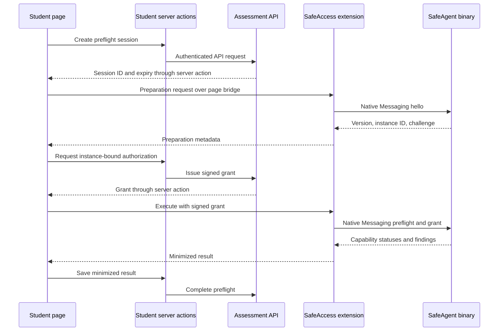
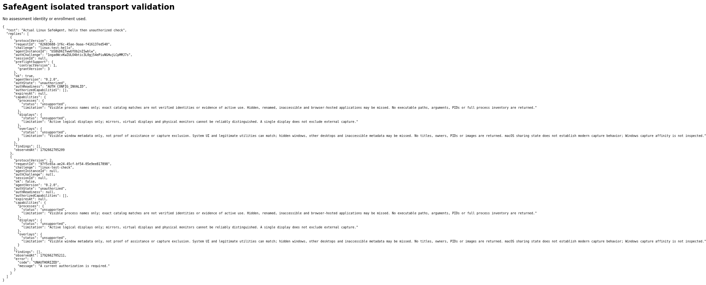
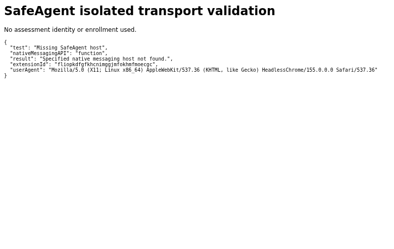
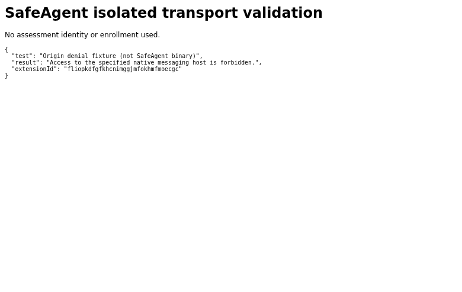

# Native Messaging architecture, security and compatibility

Technical review, 22 October 2026. Baseline: SafeAgent **0.2.0**, source commit [`36bfd9b`](https://github.com/Kalvi-Education/safe-assess-agent/tree/36bfd9b265ea67d47fbcead20f258f7bb88319f4), wire protocol **2**.

**Status:** Native transport and authorization have test evidence. This is not certification of installed-browser compatibility, Linux device probes, or public distribution readiness. SafeAgent is a standalone Rust host; the SafeAccess browser extension and Assessment API are separate integrations. Some existing source/docs retain the integration name HIBU.

## 1. Does the extension use Native Messaging or localhost?

The extension calls `chrome.runtime.connectNative('com.kalvium.safeagent')`. Chrome resolves the installed host manifest, launches the binary, and transports UTF-8 JSON over stdin/stdout. Each message has a four-byte unsigned length in native byte order. The manifest declares `type: "stdio"`. No localhost HTTP/WebSocket listener is used by SafeAgent, and the binary has no agent networking or daemon requirement.

This combines Chrome's documented transport with SafeAgent's [entry point](../src/main.rs) and [framing implementation](../src/lib.rs). The actual Linux browser exchange below corroborates transport, not successful device scanning. Localhost CDP used during testing was browser automation infrastructure, not SafeAgent communication.

## 2. What is the architecture and what crosses each boundary?

For the one-time preflight integration:

The extension carries the native instance/challenge binding and signed grant; the binary returns capability statuses and bounded findings. The extension minimizes individual findings before the page saves the summary. In this preflight path, **Student server actions—not the extension directly—call the Assessment API**. The Student access token remains server-side. Other integrations, including ongoing monitoring, have distinct lifecycle rules; see [protocol](../protocol.md).

## 3. How are allowed origins and extension IDs enforced?

Chrome's host `allowed_origins` lists exact `chrome-extension://<id>/` origins; wildcards are not allowed. The extension needs `nativeMessaging` permission. Chrome exposes the API to extension contexts, not directly to websites/content scripts.

SafeAgent adds a second check: the caller-origin argument must match the compile-time extension allowlist. Missing/invalid configuration fails closed. See [origin validation](../src/lib.rs), [launch argument handling](../src/main.rs), and [manifest generation](../packaging/write-manifest.py). Chromium rejected a synthetic extension excluded by a test manifest; evidence E2 below.

**Limit:** another local process can pass a matching origin argument itself. That argument is not cryptographic proof that Chrome launched the process. Signed scan authorization is an additional boundary, not optional protection supplied by origin matching.

## 4. Are binary paths and registration locked against replacement?

Native-host registration identifies a binary; it does not attest the binary's identity or integrity. Current macOS packaging uses system installation/Chrome registration. Current Windows packaging uses LOCALAPPDATA and HKCU, so it is not an administrator-protected installation.

The proposed administrator-protected distribution needs an explicit Windows packaging change plus file/registry permission, per-user override, and replacement tests. It must not be described as implemented across platforms. Users with administrator control can change local software; even system-owned files are not protection against the machine administrator. See [installer implementation](../packaging/windows.iss) and [macOS builder](../packaging/build-macos.sh).

## 5. What prevents unauthorized scans, tampering and replay?

The Assessment API keeps the Ed25519 private authorization key; only approved public verification keys enter the binary at compile time. The envelope contains `keyId`, encoded payload and detached signature. SafeAgent verifies the exact payload bytes and rejects unknown keys/invalid signatures.

One-time preflight authorization binds the agent instance, challenge, assessment, permitted capabilities and validity window (at most 60 seconds). The challenge is consumed before scanning, including failed probes, so a grant cannot enable a second snapshot. Missing configuration fails closed. Monitoring grants are separate and must not be confused with the one-shot preflight lifetime. See [authorization code](../src/auth.rs).

These signatures authorize requests; they do **not** encrypt stdio or sign the observations as trustworthy device evidence. Unit tests exercise scope, signature, expiry and replay boundaries; the opt-in subprocess test exercises actual compiled-key behavior. Browser-to-backend signed preflight completion was not exercised in the Linux browser session.

## 6. What are the reverse-engineering and cheating limits?

The public source and protocol are inspectable. Public keys, extension IDs and message formats are not secrets; backend private keys and platform signing credentials must remain private. Keep authoritative decisions server-side rather than relying on hidden protocol details.

A machine owner may patch the binary, replace the extension or fabricate a client result. Publisher signing can detect covered-file modification when verified, but cannot establish that every returned observation came from an authentic unmodified execution. Results are client reports—not hardware-backed attestation, proof of cheating, or exhaustive anti-cheat coverage.

## 7. Which installation operations require elevation?

Current macOS system installation/uninstall requires administrator privileges. Current Windows installation is per-user without elevation. Administrator-protected Windows installation is a planned requirement, not current behavior. Prompt cancellation, repair, upgrade and uninstall permissions still require installed-device tests. Installing with administrator approval must not imply running scans elevated.

## 8. Does execution follow least privilege?

Chrome is intended to launch SafeAgent as its ordinary desktop user, without a root service or daemon. Device probes inspect process names, active display counts and visible-window metadata; they do not collect screenshots, camera/microphone content or answers.

Actual Windows/macOS runtime identity, permission failures and desktop/session access still need validation. An available probe is not a clean-device verdict; hidden, renamed, inaccessible or browser-hosted tools can be missed. See [probe implementation](../src/probes.rs) and [overlay limitations](../src/overlays.rs).

## 9. How is binary integrity checked?

Downloaded Dev artifact checksums and provenance were validated against the build's source/workflow identity and configured public-key-ring binding. Checksums establish a match to that reference, not independent publisher trust if both artifact and reference are substituted.

Dev installers are unsigned. Trusted release signing, verification of the expected publisher, upgrade integrity and registration replacement resistance remain separate release gates. No automatic per-launch hash attestation is claimed. Authorization signatures and platform code signatures solve different problems.

## 10. Which browser/OS combinations have evidence?

| Environment | Evidence | Status |
| --- | --- | --- |
| Windows x64 | Native CI and unsigned installer build | Build validated; installed browser integration untested |
| macOS ARM64 / Intel | Native CI and unsigned installer builds | Build validated; full installed browser matrix untested |
| Debian 12 x64 / Chromium 155.0.8059.79 | Isolated synthetic extension with actual native binary | Transport and unauthorized rejection validated; probes unsupported |
| Chrome, Edge, Brave on Windows/macOS | No complete installed matrix in this review | Not tested; do not label incompatible |
| Other Chromium browsers | No explicit installed validation | Not tested |
| Windows ARM64 | No native ARM64 artifact | Not validated |
| Linux device checks | All capabilities unsupported | Not implemented |

CI runners/target compilation do not certify installed-browser behavior. Existing macOS native subprocess smoke is also not a complete browser installation test. Firefox and Safari integrations are not supplied by the current Chrome extension; this is not a claim that those browsers can never support native integrations.

## 11. What differs between browsers?

Each browser must resolve the correct manifest/registry location, binary path and approved extension ID. Current installers register Chrome; Edge/Brave configuration must be validated separately. Extension IDs can differ by distribution channel; unpacked IDs must not be assumed stable. A shared Chromium engine does not certify host lookup, policy, store identity or installation behavior.

Test the stock installer first. If manual registration is needed, record it as a configuration requirement or installer gap, not an automatic compatibility pass.

## 12. Are restart, reconnection and upgrades reliable?

The complete lifecycle is pending on Windows/macOS: fresh installation, browser restart, OS restart, reconnect, missing manifest/binary, upgrade, rollback, uninstall/reinstall. Capture expected and actual behavior with exact versions. Reconnection must obtain fresh authorization where the protocol requires it; a successful installer exit alone is insufficient.

## 13. Are boundaries consistent across profiles/users?

Not yet established. On disposable environments, test unauthorized extensions, spoofed caller arguments, registration redirection, per-user overrides, binary replacement, standard users and multiple browser profiles/OS users. Keep these distinct from protocol-unit test success. Do not weaken account enrollment, identity or assessment integrity to make compatibility tests pass.

## 14. Were Windows/macOS VM installations recorded?

No. The exercised VM was Debian, with a separate unauthenticated profile and a synthetic test extension. There is no complete Windows/macOS VM installation recording in this review. Required evidence includes elevation prompts, installed permissions/registration, ordinary-user process identity and first authorized extension connection.

## 15. What happens when the agent is unavailable?

Chromium returned a missing-host error when SafeAgent was absent. The actual binary rejected an unauthenticated check and reported missing authorization configuration rather than a clean result. These paths have browser evidence below.

Outdated-agent messaging, disconnection recovery and normal-user upgrade/reinstall UX remain untested. For the separate one-time advisory integration, advisory results do not gate Begin; this does not remove other assessment prerequisites or define monitoring policy.

## 16. Which observations require physical hardware?

Application visibility, mirrored/multiple/virtual display handling and overlay metadata need physical Windows/macOS confirmation. VM topology differs from physical devices; synthetic camera/audio proves functionality, not detection accuracy. Hidden windows, other desktops and capture behavior can evade observation. “Checked” means the probe ran successfully, not that no findings exist.

## 17. What Linux support exists?

SafeAgent 0.2.0 built on Debian 12 x64 with Rust 1.99.1. The native test suite passed 30 tests; the separately invoked actual-binary authorization test passed with ephemeral keys. Chromium communicated with the real release binary.

All Linux process/display/overlay capability statuses remain `unsupported`. This is transport feasibility, not functional Linux device-check support. X11 and Wayland require separate implementation and access evaluation; Wayland restrictions must not be worked around by falsely reporting a clean scan.

## 18. Are DEB and RPM packages production-ready?

An experimental unsigned amd64 DEB was built, inspected with `dpkg-deb --info`, extracted, and its extracted binary passed version and native smoke checks. Declared dependencies were libc6 >=2.36 and libgcc-s1. It contained a binary only, no browser registration or authorization keys, and was not installed system-wide.

| Experimental artifact property | Observed value |
| --- | --- |
| Filename | `safe-assess-agent-experimental_0.2.0_amd64.deb` |
| Size | 240720 bytes |
| SHA-256 | `b63d31ca8f6ee8ba83a9b2cf331e61236b22e2b77a2f272b8a6ea2ad4ff32b62` |

This artifact is not published as a supported release. No committed Linux installer implementation is supplied by this documentation. System installation, upgrade/uninstall, Ubuntu/other Debian releases, RPM distributions, architectures and Snap/Flatpak browser integration remain unvalidated. A functional packaging plan must specify supported distributions, privileged registration and ordinary-user runtime; packaging cannot supply missing probes.

## 19. Can institutional deployment avoid public signing?

Potentially, for centrally managed devices whose IT administrators explicitly configure and validate trust/application policies. Internal certificates and alternative signing identities are not automatically trusted by unmanaged machines. macOS ad-hoc signing is neither Developer ID identity nor Apple notarization. Administrator approval alone does not guarantee execution under Gatekeeper, SmartScreen or application-control policy.

Treat managed deployment as a separately accepted option; do not require globally disabling endpoint protection. See [Apple managed trust](https://support.apple.com/en-sg/guide/deployment/dep323ab8aa3/web) and [Microsoft internal signing](https://learn.microsoft.com/en-us/windows/security/application-security/application-control/app-control-for-business/deployment/create-code-signing-cert-for-appcontrol).

## 20. What is required for public distribution?

Windows: Authenticode-sign and timestamp binaries/installers using a trusted CA certificate or eligible Microsoft signing service. A valid signature, including EV, does not guarantee immediate SmartScreen reputation. macOS: Developer ID Application signing for code, Developer ID Installer signing for the package, notarization and stapling. Developer ID credentials require Apple Developer membership. Costs depend on provider, eligibility and current pricing.

Protect signing keys, environment approvals and version tags; verify the expected publisher and test signed installers on clean devices. Source availability and successful unsigned packaging are not release acceptance. Existing production/cloud publication flags remain default-off until separately approved. See [Apple Developer ID](https://developer.apple.com/help/account/certificates/create-developer-id-certificates/), [Microsoft reputation/signing](https://learn.microsoft.com/en-us/windows/apps/package-and-deploy/smartscreen-reputation), and [release gates](../release.md).

## Evidence appendix

Evidence collected 22 October 2026 against the baseline above. Screenshots show observed browser results, not a production assessment UI. The test extension was synthetic; no enrolled profile, assessment identity or production grant was used. JSON is supplied because full-width raw-message screenshots are difficult to read at normal GitHub width.

### E1 — Actual Linux binary, Native Messaging

Observed `hello`: `ok:true`, `authReadiness:AUTH_CONFIG_INVALID`; unauthenticated `check`: `ok:false`, `error.code:UNAUTHORIZED`. All three capability statuses were `unsupported`, with empty findings. The browser-test binary intentionally embedded no authorization keys. This proves fail-closed behavior and real browser/binary transport, not successful signed browser execution.

[Full JSON replies](evidence/native-messaging-2026-10-22/linux-real-native.json)

The screenshot includes disposable test-session challenges/IDs, not signing keys or student credentials; the connection was closed after testing.

### E2 — Missing host and browser origin rejection

Absent `com.kalvium.safeagent`: **Specified native messaging host not found.** Synthetic host excluding the caller extension: **Access to the specified native messaging host is forbidden.** The denied-host fixture used `/usr/bin/false`, not SafeAgent: that result proves Chromium's manifest enforcement only.

[Structured browser results](evidence/native-messaging-2026-10-22/linux-chromium-native-results.json)

### E3 — Authorization test scope

Executed `cargo test --locked` (30 passed) and `cargo test --locked --test binary-authorization -- --ignored` (one actual-binary test passed). The latter compiles with ephemeral public keys and checks real subprocess authorization and rejection of runtime key replacement. Unit tests additionally exercise signature, scope, expiry and replay. These are recorded outcomes, not a substitute for platform/browser tests. Original runner console logs are not attached here; reproduce from the baseline with Cargo. See [authorization tests](../tests/binary-authorization.rs) and [unit tests](../src/auth.rs).

### E4 — Dev artifact integrity

[Unsigned packaging run 39720635711](https://github.com/Kalvi-Education/safe-assess-agent/actions/runs/39720635711) succeeded for Windows x64 and macOS ARM64/Intel. Downloaded checksums/provenance passed local catalog validation. Run artifacts have retention limits and may expire. See [catalog validator](../packaging/internal-dev-catalog.py) and [native CI](../.github/workflows/safeagent-ci.yml). No private cloud identifiers or credentials are required to inspect this document.

### E5 — Experimental DEB scope

Only package creation/inspection/extraction and extracted-binary smoke were exercised. No DEB system installation, distribution support certification or RPM build was performed. The hash above identifies the local experimental artifact; absence of a public downloadable installer is intentional.

## Remaining acceptance gates

Before declaring supported distribution: complete the Windows/macOS browser matrix, privileges and registration tests, genuine backend-authorized browser execution, lifecycle/rollback, disposable tampering tests, physical-device observations, and signed-install trust checks. Record exact OS/browser/extension/agent versions and distinguish **pass**, **fail**, **not tested** and **not implemented**. Do not infer compatibility from compilation or infer cheating from limited observations.
